# Habla Fluido: aprende inglés con un tutor de IA

App de Flutter hecha con TDD para practicar inglés: pronunciación (shadowing), oído (dictado), lectura, escritura y conversación con un tutor de IA, más repetición espaciada (SM-2) y un plan diario de 20 minutos que da más tiempo a la habilidad más débil. Sigue el *Manual paso a paso con TDD: Habla Fluido*.

```
lib/
  dominio/       reglas, nivel, comparador, repaso (SM-2), progreso, plan_diario,
                 frase, lectura, tutor, voz, almacen, excepciones
  datos/         tutor_simulado, tutor_http, voz_real, voz_simulada, almacen_avance
  presentacion/  vm/ (7 ViewModels) y pantallas/
proxy/           servidor Node que guarda la llave y el prompt de la IA
test/            comparador, repaso_progreso, tutor, vms
```

## Fase 1. El comparador: ¿qué tan bien lo dijiste?

Alinea palabra por palabra la frase esperada contra lo que el estudiante dijo o escribió (programación dinámica, como el *diff* de Git) y usa la distancia de Levenshtein para marcar palabras "parecidas".

Pruebas (`test/comparador_test.dart`):

1. Normalizar: minúsculas, sin puntuación, conserva apóstrofos.
2. Levenshtein y similitud de 0 a 1.
3. Frase idéntica = 100%; par mínimo ship/sheep y think/tink.
4. Palabra omitida, palabra sobrante, nada dicho y esperado vacío.
5. El puntaje nunca baja de 0 ni pasa de 1.

### Fase roja

La prueba falla porque todavía no existe el comparador.

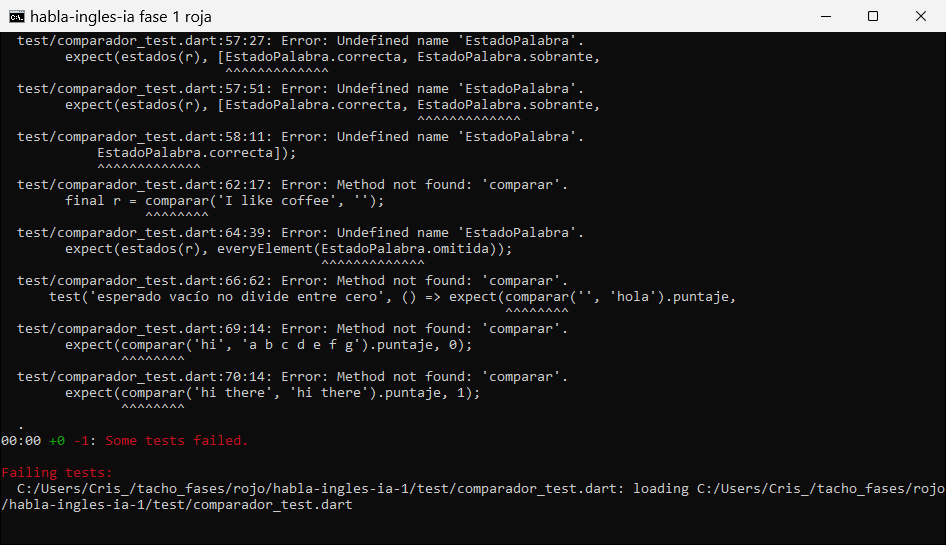

### Fase verde

Se agrega `comparador.dart`. Las 12 pruebas pasan.

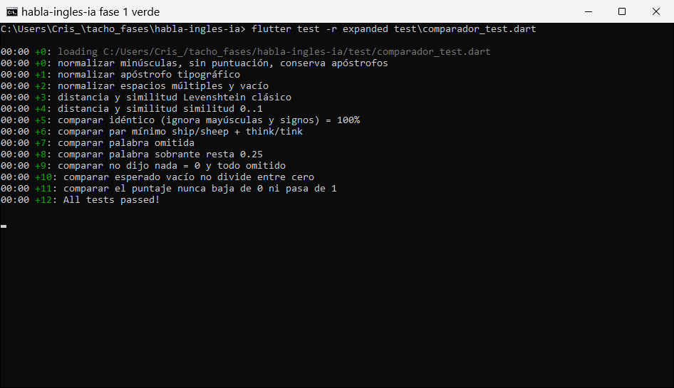

## Fase 2. Repetición espaciada, progreso y plan diario

SM-2 decide cuándo repasar cada frase. El progreso usa un promedio móvil exponencial por habilidad, cuenta la racha de días y solo sube de nivel cuando todas las habilidades están dominadas. El plan reparte 20 minutos con el método del mayor resto.

Pruebas (`test/repaso_progreso_test.dart`):

1. SM-2 con la secuencia 4, 5, 5, 2; facilidad mínima 1.3; fechas en días completos.
2. Calidad desde el puntaje, JSON de ida y vuelta y mazo de repaso.
3. EMA, racha, habilidad más débil y subir de nivel.
4. El plan suma exactamente los minutos y refuerza la habilidad débil.

### Fase roja

La prueba muestra el error antes de implementar el repaso, el progreso y el plan.

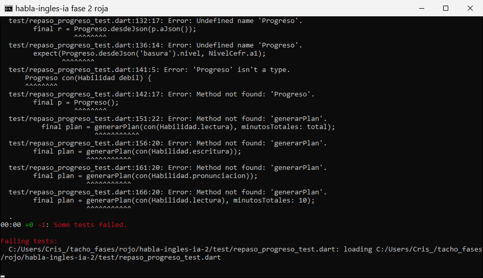

### Fase verde

Se agregan `repaso.dart`, `progreso.dart` y `plan_diario.dart`. Las 20 pruebas pasan.

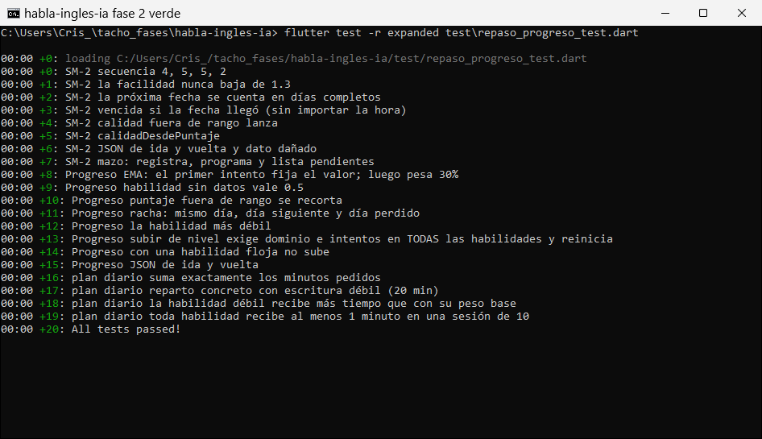

## Fase 3. El tutor: simulado y por HTTP

La respuesta de la IA se trata como entrada no confiable y se valida. El tutor simulado corrige errores típicos de hispanohablantes sin internet. El cliente HTTP exige HTTPS, recorta el historial y nunca muestra detalles técnicos.

Pruebas (`test/tutor_test.dart`):

1. JSON limpio o con cercas de markdown; correcciones incompletas descartadas; basura rechazada.
2. Tutor simulado: "I am agree", "he go", máximo 2 correcciones por turno.
3. Cliente HTTP: exige HTTPS, envía nivel, modo y token, recorta a 20 mensajes y 500 caracteres.
4. Errores de red o de servidor → mensaje genérico; acentos y ñ llegan bien.

### Fase roja

La prueba falla mientras todavía no existen el contrato del tutor ni sus implementaciones.

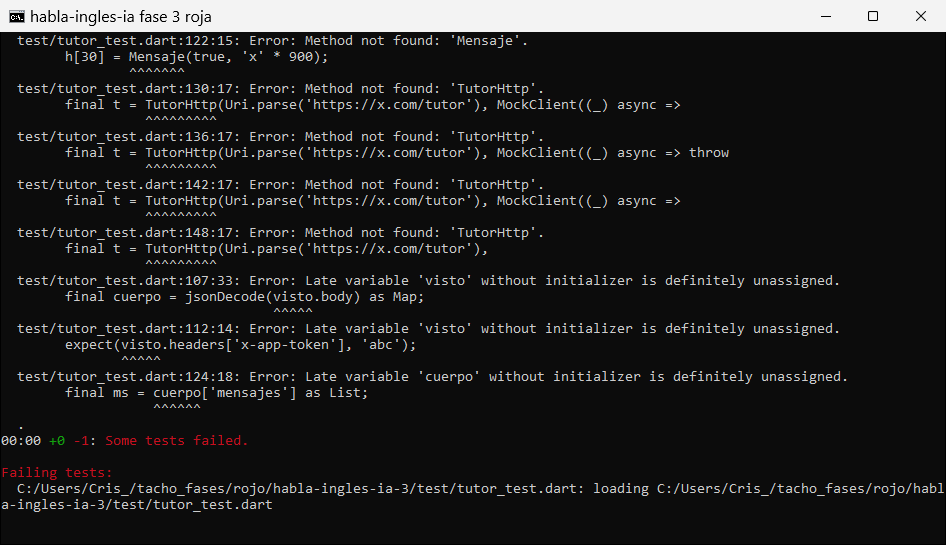

### Fase verde

Se agregan `tutor.dart`, `tutor_simulado.dart` y `tutor_http.dart`. Las 17 pruebas pasan.

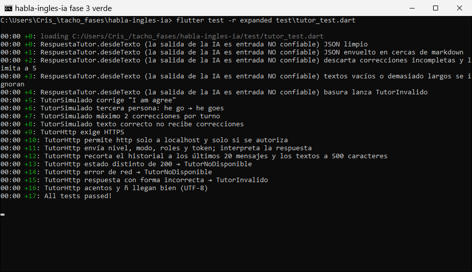

## Fase 4. ViewModels de cada ejercicio

Cada ejercicio tiene su ViewModel y todos reportan al `AprendizajeViewModel`, que guarda el progreso y las tarjetas.

Pruebas (`test/vms_test.dart`):

1. Pronunciación: compara, registra, maneja silencio, velocidad lenta y doble toque.
2. Dictado, lectura (una respuesta por pregunta) y escritura (mínimo 5 palabras).
3. Conversación: turno completo, voz opcional, reintento sin duplicar roles, dictado por voz.
4. Persistencia del avance, fallo al guardar y repaso con recuperación activa.

### Fase roja

La prueba muestra el error antes de crear los ViewModels.

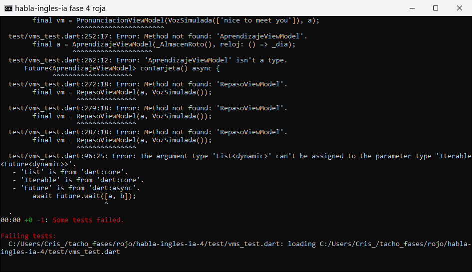

### Fase verde

Se agregan los 7 ViewModels. Las 29 pruebas pasan.

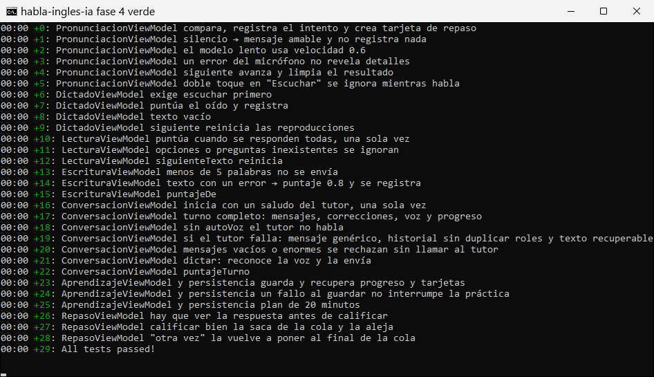

## Fase 5. Todas las pruebas

Con las pantallas (inicio con plan del día, pronunciación, dictado, lectura, escritura, conversación y repaso) y la raíz de composición, se corre `flutter test` completo: 78 pruebas.

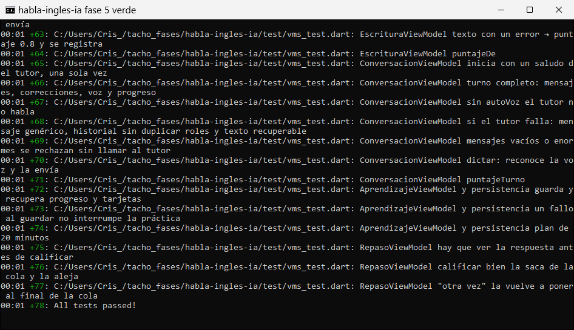

## Cómo probarla

```
flutter pub get
flutter test
flutter run                                    # tutor simulado, sin internet
flutter run --dart-define=TUTOR_URL=https://tu-servidor.com/tutor
```

El proxy de la IA está en `proxy/` (`node --test` y `node server.js` con `ANTHROPIC_API_KEY` en el entorno). La llave nunca va dentro de la app. El micrófono necesita permisos `RECORD_AUDIO` en Android y `NSMicrophoneUsageDescription` / `NSSpeechRecognitionUsageDescription` en iOS.

## Resultado

Las cuatro capas del proyecto se construyeron con el ciclo rojo → verde, con su evidencia en cada fase y la corrida final de las 78 pruebas.

## App corriendo en el emulador

<!-- APP_INICIO -->
Capturas tomadas en el emulador de Android con `flutter drive` (prueba de integraci&oacute;n `integration_test/capturas_test.dart`, que recorre la app y toma una foto de cada pantalla).

**La app abierta en el emulador**

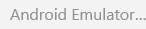

| | | |
|:-:|:-:|:-:|
| 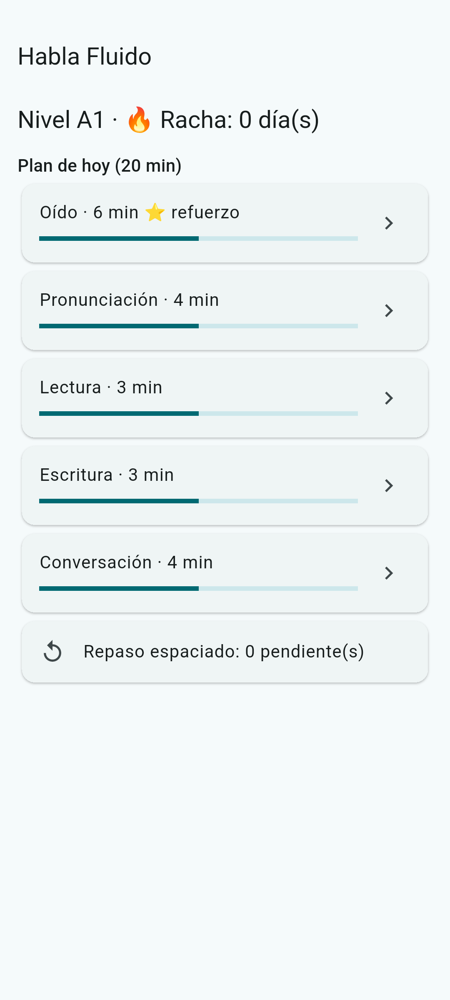<br>Inicio plan de hoy | 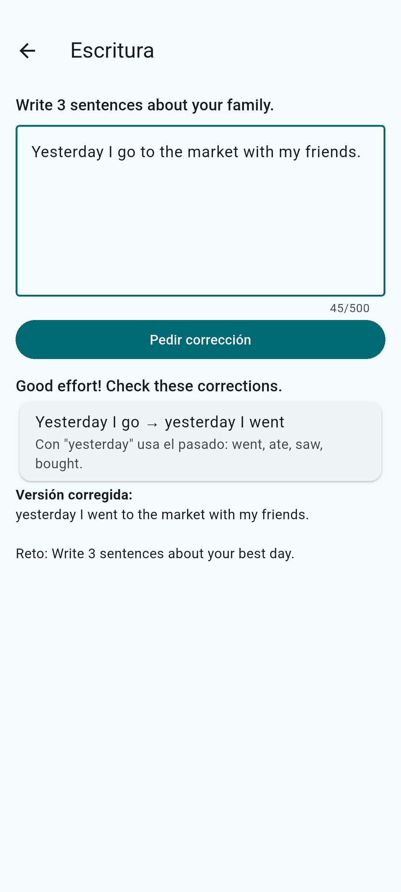<br>Escritura con correccion | 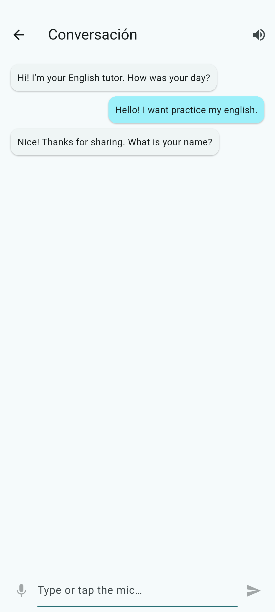<br>Conversacion con el tutor |
| 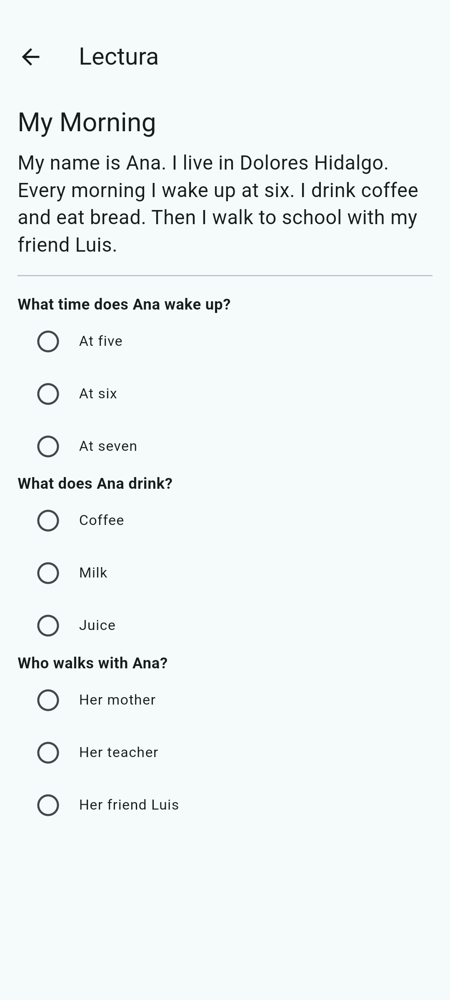<br>Lectura | 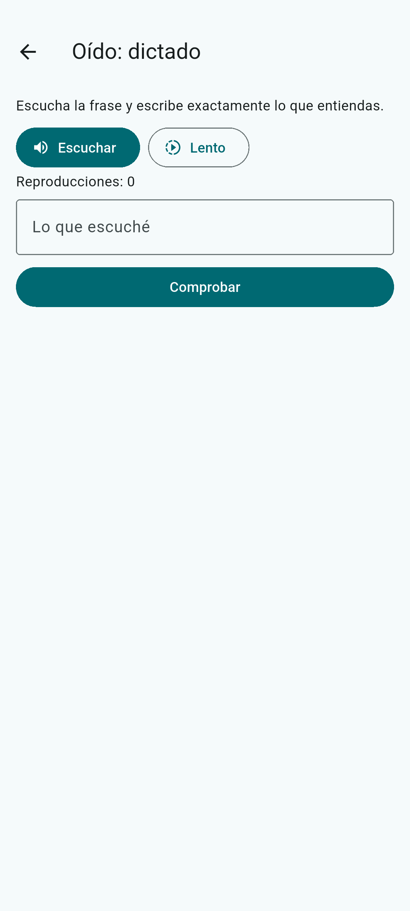<br>Dictado | 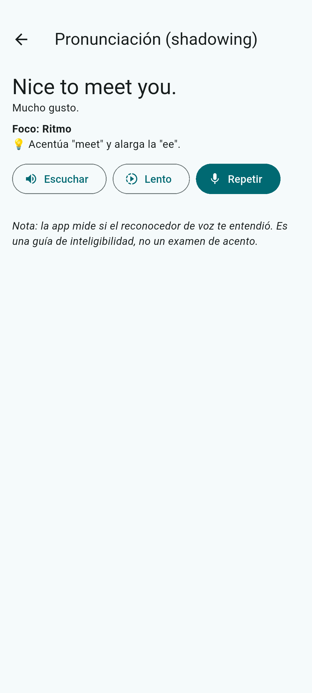<br>Pronunciacion |
| 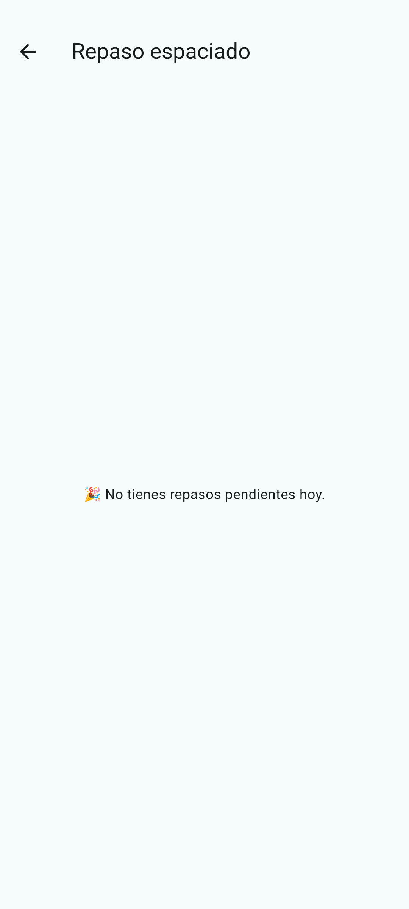<br>Repaso espaciado |   |   |

**La prueba de integraci&oacute;n ejecutada desde el cmd**

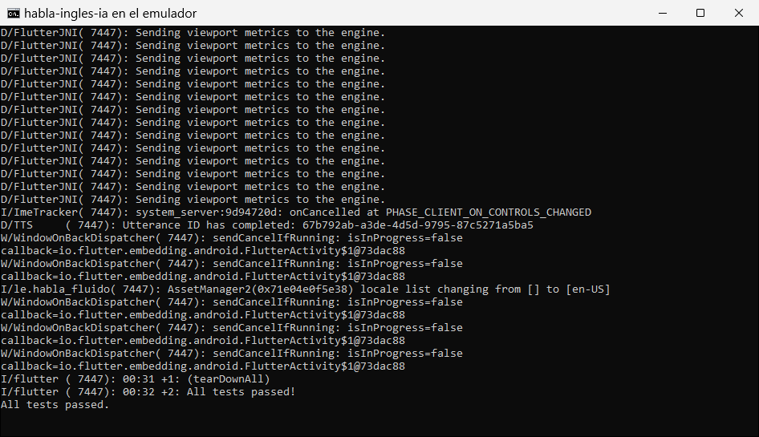

<!-- APP_FIN -->
